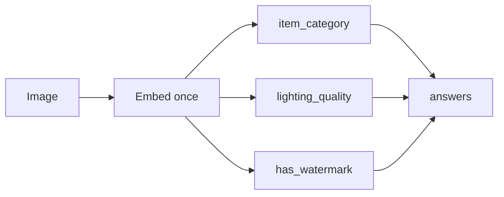

`POST /v1/systemone`

Evaluates several visual questions against one image in a single forward pass. This endpoint is also available as `POST /v1/decide`.

## How it works

The image is embedded once. Every question is then evaluated against that single embedding, so adding questions adds comparatively little work. Sending one request with many questions is faster than sending many separate requests for the same image.



## Request

### Headers

| Header | Type | Required | Description |
| --- | --- | --- | --- |
| `Content-Type` | `string` | Yes | Must be `application/json`. |
| `X-API-Key` | `string` | Conditional | Required in `production` and `staging` environments. |

### Body parameters

| Parameter | Type | Required | Limit | Description |
| --- | --- | --- | --- | --- |
| `image` | `string` | Yes | 10 MB | A public image URL, a Base64 string, or a data URI. |
| `questions` | `object` | Yes | 1 to 25 questions | Maps a unique identifier you choose to a question definition. |

Each entry in `questions` contains:

| Field | Type | Description |
| --- | --- | --- |
| `decision` | `string` | The plain-language question. |
| `schema` | `object` | A [Choice](/primitives/choice), [Score](/primitives/score), or [Noul](/primitives/noul) definition. |

## Example request

<CodeGroup>
```bash cURL
curl -X POST "https://api.imagejev.dev/v1/systemone" \
  -H "X-API-Key: YOUR_API_KEY" \
  -H "Content-Type: application/json" \
  -d '{
    "image": "https://images.unsplash.com/photo-1542291026-7eec264c27ff",
    "questions": {
      "item_category": {
        "decision": "Identify the primary merchandise category",
        "schema": {
          "type": "choice",
          "options": {
            "footwear": "shoes, sneakers, boots, or sandals",
            "apparel": "shirts, pants, jackets, or clothing",
            "accessories": "jewelry, hats, bags, or belts"
          }
        }
      },
      "lighting_quality": {
        "decision": "Rate studio lighting quality",
        "schema": {
          "type": "score",
          "levels": [
            "dark or underexposed",
            "uneven harsh shadows",
            "clear ambient lighting",
            "flawless studio balanced exposure"
          ]
        }
      },
      "has_watermark": {
        "decision": "Is there a watermark or copyright text overlay?",
        "schema": {
          "type": "noul",
          "true": "visible translucent watermark, logo stamp, or copyright text",
          "false": "clean photo with no watermark or text stamps"
        }
      }
    }
  }'
```

```python Python SDK
from imagejev import ImageJevClient

client = ImageJevClient(base_url="https://api.imagejev.dev", api_key="YOUR_API_KEY")

result = client.decide_multi(
    image="https://images.unsplash.com/photo-1542291026-7eec264c27ff",
    questions={
        "item_category": {
            "decision": "Identify the primary merchandise category",
            "schema": {
                "type": "choice",
                "options": {
                    "footwear": "shoes, sneakers, boots, or sandals",
                    "apparel": "shirts, pants, jackets, or clothing",
                    "accessories": "jewelry, hats, bags, or belts",
                },
            },
        },
        "lighting_quality": {
            "decision": "Rate studio lighting quality",
            "schema": {
                "type": "score",
                "levels": [
                    "dark or underexposed",
                    "uneven harsh shadows",
                    "clear ambient lighting",
                    "flawless studio balanced exposure",
                ],
            },
        },
        "has_watermark": {
            "decision": "Is there a watermark or copyright text overlay?",
            "schema": {
                "type": "noul",
                "true": "visible translucent watermark, logo stamp, or copyright text",
                "false": "clean photo with no watermark or text stamps",
            },
        },
    },
)

print(result["item_category"].choice)       # "footwear"
print(result["lighting_quality"].score)     # 3.84
print(result["has_watermark"].probability)  # 0.012 (no watermark)
```

```typescript TypeScript
const response = await fetch("https://api.imagejev.dev/v1/systemone", {
  method: "POST",
  headers: {
    "X-API-Key": "YOUR_API_KEY",
    "Content-Type": "application/json",
  },
  body: JSON.stringify({
    image: "https://images.unsplash.com/photo-1542291026-7eec264c27ff",
    questions: {
      item_category: {
        decision: "Identify product category",
        schema: {
          type: "choice",
          options: {
            footwear: "shoes, sneakers, or boots",
            apparel: "clothing or garments",
          },
        },
      },
    },
  }),
});

const data = await response.json();
console.log(data.answers.item_category);
```
</CodeGroup>

## Response

A successful request returns `200 OK`. Results are grouped under `answers`, keyed by your question identifiers. Each answer has the same fields as [`POST /decide`](/api-reference/decide) for its schema type.

```json
{
  "answers": {
    "item_category": {
      "choice": "footwear",
      "probability": 0.9921,
      "confidence": 0.9842,
      "is_relevant": true,
      "relevance": 0.334,
      "probabilities": {
        "footwear": 0.9921,
        "apparel": 0.0051,
        "accessories": 0.0028
      }
    },
    "lighting_quality": {
      "score": 3.84,
      "probability": 0.881,
      "confidence": 0.932,
      "dispersion": 0.038,
      "legend": {
        "0": "dark or underexposed",
        "1": "uneven harsh shadows",
        "2": "clear ambient lighting",
        "3": "flawless studio balanced exposure"
      },
      "probabilities": { "0": 0.001, "1": 0.012, "2": 0.106, "3": 0.881 }
    },
    "has_watermark": {
      "probability": 0.0124
    }
  }
}
```

<Note>
  For a Noul question, `probability` is the probability that the `true` statement applies. Here, `0.0124` means a watermark is unlikely.
</Note>

## Limits

A request can contain at most 25 questions. More than 25 returns `400 Bad Request`.
