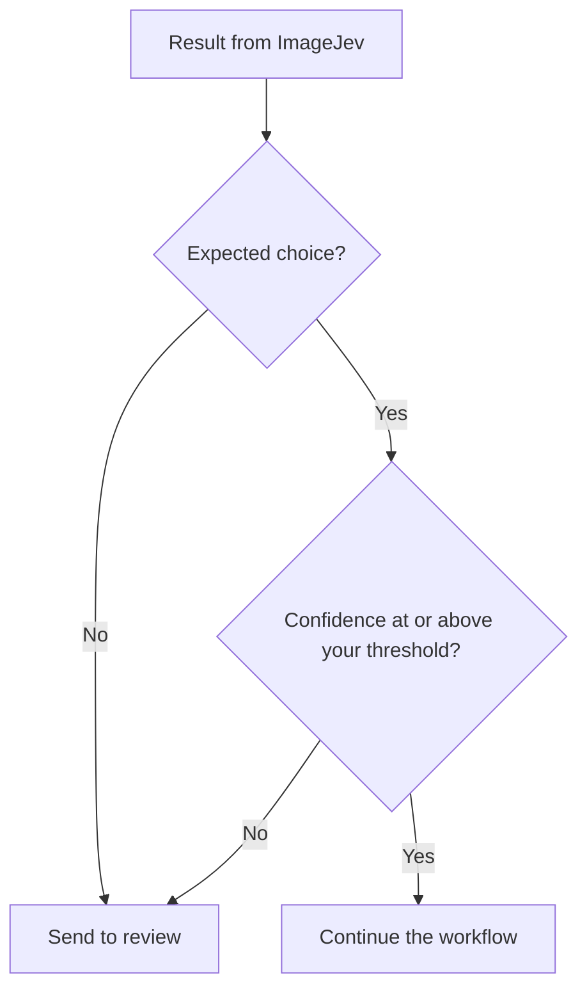

`choice` and `score` results include a `confidence` value between `0.0` and `1.0`. Use it to decide whether to automate a result or send it for review.

<Warning>
  Confidence is not a guarantee that a result is correct. It describes how concentrated the probabilities are, not how often the answer is right.
</Warning>

## How confidence works

| Field | What it tells you | Returned by |
| --- | --- | --- |
| `probability` | The probability assigned to the selected option. | Choice, Score, Noul |
| `confidence` | How concentrated the probability distribution is, computed from its entropy. Higher means one outcome clearly dominates. | Choice, Score |

Noul results return `probability` only.

## Route on confidence

Check both the outcome and the confidence before continuing automatically.



```python
result = jev.decide(
    image="photo.jpg",
    decision="Is this upload ready?",
    schema={
        "type": "choice",
        "options": {
            "ready": "clear and complete upload",
            "review": "unclear or incomplete upload",
            "other": "not an applicable upload",
        },
    },
)

if result.confidence >= 0.85 and result.choice == "ready":
    continue_workflow()
else:
    send_to_review()
```

## Choose a threshold

There is no universal threshold. Measure it on representative examples from your workflow.

<Steps>
  <Step title="Collect examples">
    Gather real images from your workflow, including unclear and out-of-scope ones.
  </Step>
  <Step title="Run and record">
    Run ImageJev on each image and store the choice and confidence next to the correct answer.
  </Step>
  <Step title="Measure">
    For each candidate threshold, measure how often automated results are correct, how many cases can be automated, and how many uncertain cases reach review.
  </Step>
  <Step title="Pick and revisit">
    Choose the threshold that fits the cost of a wrong decision. Revisit it when your images or business rules change.
  </Step>
</Steps>

## Practical guidance

- Keep an `other` option when an image may be out of scope.
- Use `allow_none` when abstaining is better than forcing a choice.
- For Score, also inspect [`dispersion`](/primitives/score) to catch split results.
