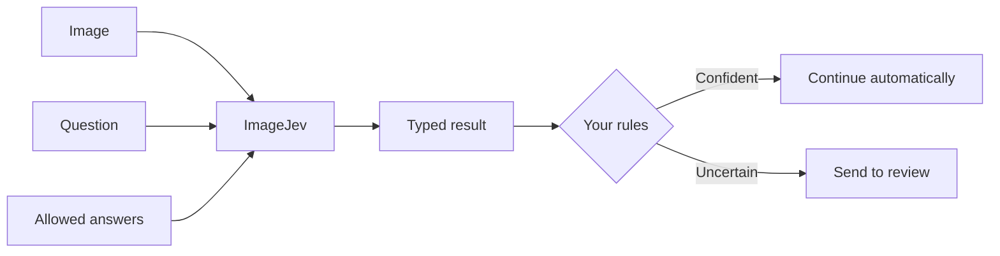

ImageJev helps software make focused decisions about images. You provide an image, a question, and the answers your workflow accepts. ImageJev returns a structured result that your code can inspect, store, or route for review.

## What you can check

ImageJev is designed for focused visual checks, such as:

- Is this product photo suitable for a listing?
- Which category best describes this image?
- How clear or complete is this upload?
- Should this item be sent to review?

## Three decision types

Every request uses one of three decision types. Pick the one that matches the answer your workflow needs.

| Type | Use it for | Returns |
| --- | --- | --- |
| [Choice](/primitives/choice) | Select one option from a defined list | `choice`, `probabilities`, `confidence` |
| [Score](/primitives/score) | Rate an image against ordered levels | `score`, `probabilities`, `confidence`, `dispersion` |
| [Noul](/primitives/noul) | Check one visual statement (yes or no) | `probability` |

## Keep questions focused

Ask one clear question at a time. If a workflow depends on several independent checks, ask them separately and combine the results in your own application logic. See [Example use cases](/use-cases) for a worked pattern.

## Important limitations

<Warning>
  Structured output does not guarantee a correct prediction. A defined list of options can still produce a confident but incorrect result when an image is unclear or outside the question.
</Warning>

- Include an explicit `other` option, or use `allow_none`, when out-of-scope images are possible.
- Validate [confidence](/concepts/confidence) thresholds on data from your own task.
- The interactive demo on the product website is illustrative. It does not call a live inference service.

## Next steps

<CardGroup cols={2}>
  <Card title="Quickstart" icon="rocket" href="/quickstart">
    Send your first decision in under 60 seconds.
  </Card>

  <Card title="Example use cases" icon="lightbulb" href="/use-cases">
    Practical patterns for catalog checks, triage, and routing.
  </Card>

  <Card title="Decision types" icon="sliders" href="/primitives/choice">
    Choose between Choice, Score, and Noul.
  </Card>

  <Card title="REST API reference" icon="code" href="/api-reference/overview">
    Endpoints, authentication, limits, and errors.
  </Card>
</CardGroup>
