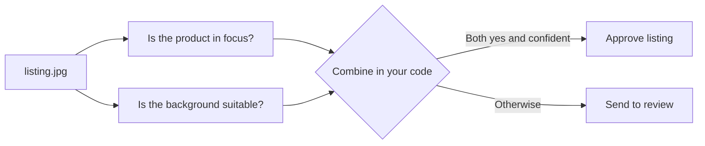

ImageJev works best as a focused decision step inside a larger workflow. Keep the question clear, define the outcomes your application can handle, and send uncertain cases for review.

## Common patterns

| Use case | What it does |
| --- | --- |
| Catalog photo checks | Check focus, lighting, background, or listing suitability before publishing an item. |
| Upload triage | Separate usable uploads from unclear or irrelevant images before the next step. |
| Document intake | Route likely receipts, forms, or other image types to the right workflow. |
| Human review routing | Use confidence and relevance signals to send ambiguous cases to a person. |

## Catalog photo checks

Ask one question about the photo, include an `other` option for images that are not product photos, and approve only confident results.

```python
from imagejev import ImageJev

jev = ImageJev()
result = jev.decide(
    image="listing.jpg",
    decision="Is this photo ready for a product listing?",
    schema={
        "type": "choice",
        "options": {
            "ready": "clear, focused, well-lit product photo",
            "needs_review": "blurry, dark, cluttered, or damaged photo",
            "other": "not a product photo",
        },
    },
)

if result.choice == "ready" and result.confidence >= 0.85:
    approve_listing()
else:
    send_to_review()
```

## Split complex checks

Instead of one broad question, ask focused questions and combine the answers in your own code.



```python
focus = jev.decide(
    image="listing.jpg",
    decision="Is the product in focus?",
    schema={
        "type": "choice",
        "options": {
            "yes": "sharp edges and visible product details",
            "no": "soft focus, motion blur, or unreadable details",
        },
    },
)

background = jev.decide(
    image="listing.jpg",
    decision="Is the background suitable for a listing?",
    schema={
        "type": "choice",
        "options": {
            "yes": "clean, simple, non-distracting background",
            "no": "cluttered, distracting, or inappropriate background",
        },
    },
)

ready = focus.choice == "yes" and background.choice == "yes"
confident = min(focus.confidence, background.confidence) >= 0.85

if ready and confident:
    approve_listing()
else:
    send_to_review()
```

<Tip>
  To ask several questions about the same image in one request, use the [multi-question endpoint](/api-reference/systemone).
</Tip>

## Review routing

Confidence helps route work, but choose a threshold using examples from your own data.

```python
if result.confidence >= 0.85 and result.choice != "other":
    continue_workflow()
else:
    send_to_review()
```

## Keep expectations clear

<Warning>
  Results are structured, but they are not a guarantee of correctness. The examples on this page are not accuracy or cost guarantees.
</Warning>

- Include an `other` option when images can fall outside the question.
- Validate thresholds on representative examples from your task.
- Revisit thresholds when your images or business rules change.
